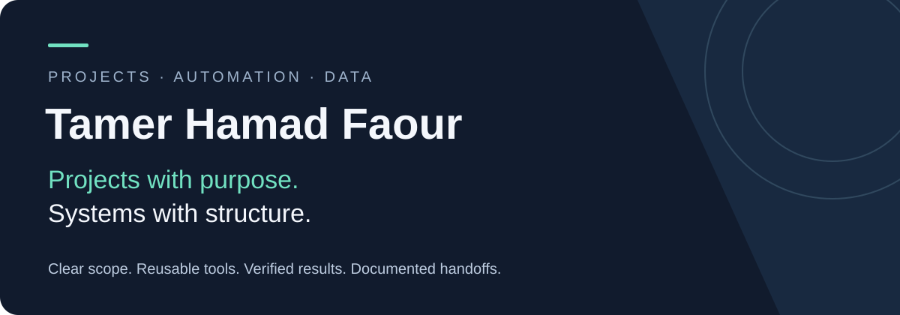
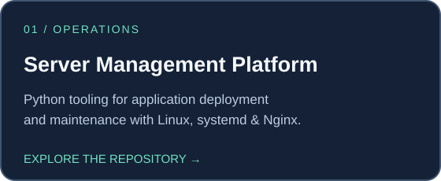
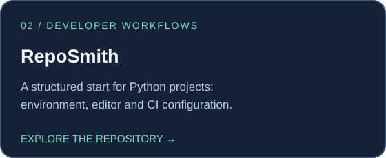
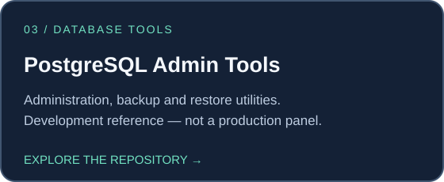
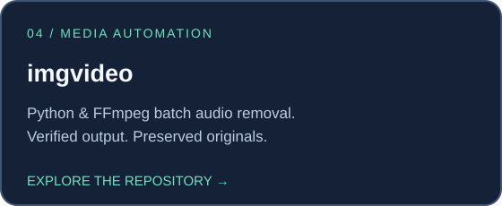
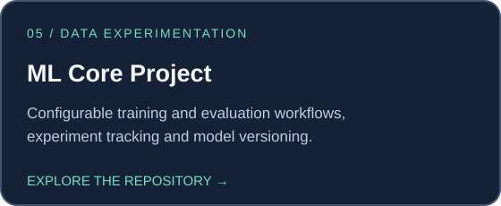

  

<strong>Project organization &nbsp; / &nbsp; Operational workflows &nbsp; / &nbsp; Practical automation</strong>

I organize and develop software projects that connect **automation, data workflows, and developer tools**. My focus is on clear scope, reusable components, documented operating procedures, and changes that can be reviewed and verified.

## A portfolio built around practical work

Each project addresses a specific workflow. Explore the repositories for their current scope, setup instructions, and limitations.

## How I organize the work

### 01 · Define the goal
Turn technical ideas into clear scopes, responsibilities, and manageable deliverables.

### 02 · Connect the workflow
Bring setup, configuration, data processing, maintenance, and recovery into a consistent structure.

### 03 · Build for continuity
Favor reusable components, traceable changes, and practical documentation that helps the next person understand and extend the project.

### 04 · Verify and hand over
Review the result, make limitations explicit, and document how the software is operated.

---

### Technical foundation

**Python** · **SQL / PostgreSQL** · **SQLAlchemy** · **scikit-learn**  
**FFmpeg** · **Linux / WSL** · **Git** · **GitHub Actions**

The technologies above reflect the documented public portfolio. Each repository provides its own setup and current limitations.

<a href="https://github.com/TamerOnLine?tab=repositories"><strong>Explore all public repositories →</strong></a>

