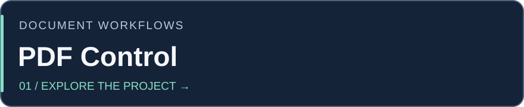
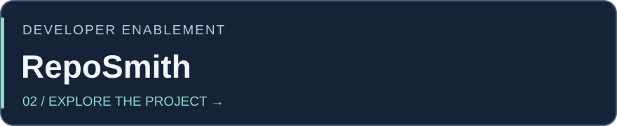
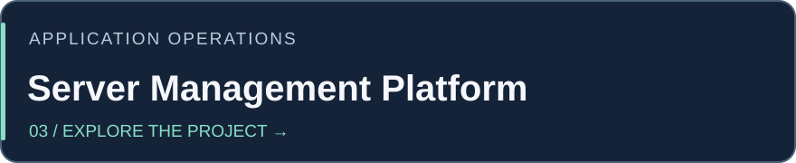
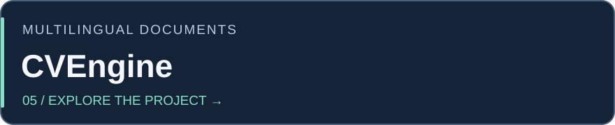
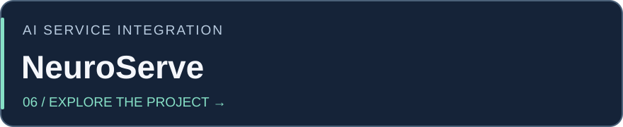
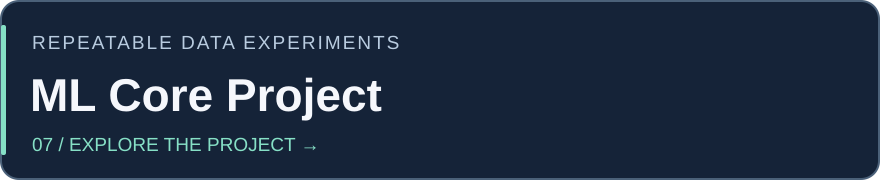

<strong>Project organization &nbsp; · &nbsp; Operational automation &nbsp; · &nbsp; Software integration</strong>

I organize and develop software around practical workflows: how a project starts, how its parts connect, how it is operated, and how the next person can understand it. My public work spans developer tooling, application operations, document and media tools, and AI/data experiments.

<a href="#selected-public-work">Selected work</a> &nbsp; / &nbsp; <a href="#how-i-approach-a-project">Working approach</a> &nbsp; / &nbsp; <a href="#technical-foundation">Technical foundation</a>

## Selected public work

A local PDF workspace for editing, conversion and document processing, with a Python engine and a Phoenix LiveView integration. The repository includes worker isolation, recovery and release-bundle verification.

**Python application + LiveView integration.** [Architecture & operating notes](https://github.com/ToolOnWeb/Rpdf/blob/main/docs/LIVEVIEW_OPERATING_AR.md) · [Verification workflows](https://github.com/ToolOnWeb/Rpdf/actions)

*Published under the ToolOnWeb organization.*

Turns a new Python project into a consistent workspace: entry files, environment setup, editor configuration and CI scaffolding. Its modular commands and test suite make the setup workflow inspectable and extendable.

**Project bootstrapper.** [Source & setup](https://github.com/TamerOnLine/reposmith-init) · [Tests](https://github.com/TamerOnLine/reposmith-init/tree/main/tests)

Brings application provisioning, environment configuration and update commands into a Python CLI around Linux, systemd and Nginx. A concrete example of organizing operations through a shared interface.

**Operational toolkit · latest reviewed CI failing (16 Aug 2026).** [Release v0.1.0](https://github.com/TamerOnLine/server_management_platform/releases/tag/v0.1.0) · [CI to review before deployment](https://github.com/TamerOnLine/server_management_platform/actions/runs/31974566545)

A batch image workflow for resizing by pixels or print dimensions, applying masks, filtering numbered files and exporting a ZIP. It connects everyday media work with a focused browser interface.

**Packaged image tool · release v0.1.1.** [Release](https://github.com/TamerOnLine/imagectl/releases/tag/v0.1.1) · [Processing source](https://github.com/TamerOnLine/imagectl/blob/main/src/imagectl/app.py)

An interactive resume-builder prototype connecting a FastAPI PDF backend with a Streamlit editor. Modular document blocks, themes and layouts provide a practical structure for Arabic, English and German resume content.

**Application prototype.** [Generation backend](https://github.com/TamerOnLine/CVEngine/tree/main/api) · [Editor](https://github.com/TamerOnLine/CVEngine/tree/main/streamlit)

A FastAPI and PyTorch service prototype with explicit CPU/GPU selection and a plugin registry for model integrations. It explores how different model capabilities can share one service interface.

**Extensible service prototype.** [Runtime selection](https://github.com/TamerOnLine/NeuroServe/blob/main/app/runtime.py) · [Plugin system](https://github.com/TamerOnLine/NeuroServe/tree/main/app/plugins)

A configurable scikit-learn workflow for preprocessing, model selection, training and evaluation. Experiment records and versioned model artifacts keep the stages connected without putting every experiment in a separate script.

**Research workflow toolkit.** [Training pipeline](https://github.com/TamerOnLine/ml-core-project/blob/main/ml_core_project/ml_core.py) · [Model versioning](https://github.com/TamerOnLine/ml-core-project/blob/main/ml_core_project/model_versioning.py)

## How I approach a project

**Define the outcome → structure the work → connect the parts → verify → document the handoff.**

- **Make the scope clear.** Give each tool a concrete purpose and keep responsibilities understandable.
- **Standardize repeated work.** Use shared commands, configuration and reusable components where the workflow calls for them.
- **Keep operations visible.** Make setup, validation, recovery and release steps inspectable.
- **Leave a useful handoff.** Document how to run the project and distinguish experiments from operational tools.

## Technical foundation

**Python** · **SQL / PostgreSQL** · **FastAPI** · **Elixir / Phoenix LiveView**  
**scikit-learn / PyTorch** · **Pillow / FFmpeg** · **Linux / WSL** · **GitHub Actions**

These technologies appear across my public repositories. Repository documentation, tests and release notes provide each project's current scope.

<strong><a href="https://github.com/TamerOnLine?tab=repositories">Explore the public repositories →</a></strong>

